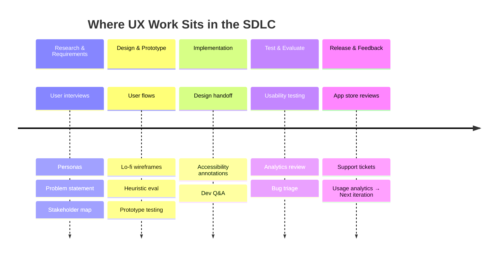
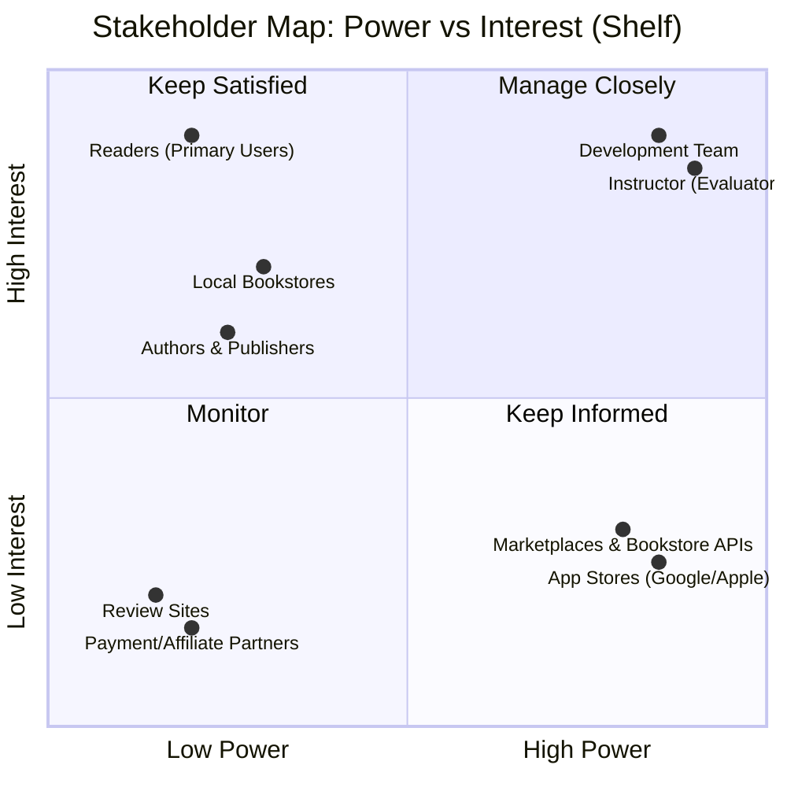
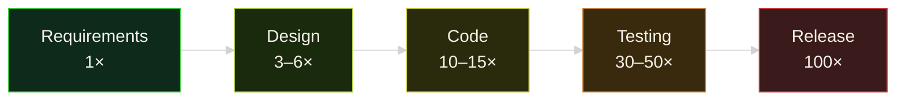

```mermaid
%%{init: {'theme': 'dark'}}%%
graph TD
    subgraph INVEST[INVEST Criteria]
        I[Independent]
        N[Negotiable]
        V[Valuable]
        E[Estimable]
        S[Small]
        T[Testable]
    end

    subgraph S1[Story 1: Compare Prices]
        S1I[✅ Pass]
        S1N[✅ Pass]
        S1V[✅ Pass]
        S1E[⚠️ Country scope needed]
        S1S[⚠️ One country per sprint]
        S1T[✅ Pass]
    end

    subgraph S2[Story 2: Synced Progress]
        S2I[✅ Pass]
        S2N[✅ Pass]
        S2V[✅ Pass]
        S2E[⚠️ Sync conflict rule needed]
        S2S[✅ Pass]
        S2T[✅ Pass]
    end

    subgraph S3[Story 3: Drop Warning]
        S3I[❌ Depends on Story 2]
        S3N[✅ Pass]
        S3V[✅ Pass]
        S3E[✅ Pass]
        S3S[✅ Pass]
        S3T[✅ Pass]
    end

    style I fill:#1a1a1a,stroke:#e8dccc
    style N fill:#1a1a1a,stroke:#e8dccc
    style V fill:#1a1a1a,stroke:#e8dccc
    style E fill:#1a1a1a,stroke:#e8dccc
    style S fill:#1a1a1a,stroke:#e8dccc
    style T fill:#1a1a1a,stroke:#e8dccc
```

# Diagram Prompts & Mermaid Source

All diagrams are rendered as Mermaid. Use in: Notion, Obsidian, GitHub, GitLab, HackMD, or any Mermaid-compatible viewer. For PowerPoint: export as SVG → insert.

---

## 1. SDLC UX Placement (`sdlc-ux-placement.mmd`)

### Mermaid Source


### Prompt for Regeneration
> Create a horizontal timeline diagram showing the SDLC phases (Research & Requirements, Design & Prototype, Implementation, Test & Evaluate, Release & Feedback) with UX activities listed under each phase. Use a clean, minimal style suitable for a dark-theme presentation. Label the timeline "Where UX Work Sits in the SDLC". Activities: Research → User interviews, Personas, Problem statement, Stakeholder map; Design → User flows, Lo-fi wireframes, Heuristic eval, Prototype testing; Implementation → Design handoff, Accessibility annotations, Dev Q&A; Test → Usability testing, Analytics review, Bug triage; Release → App store reviews, Support tickets, Usage analytics → Next iteration.

---

## 2. Stakeholder Map — Power/Interest Grid (`stakeholder-map.mmd`)

### Mermaid Source


### Prompt for Regeneration
> Create a Power/Interest quadrant chart (2x2 grid) for the Shelf app stakeholders. Axes: X = Power (Low to High), Y = Interest (Low to High). Quadrants: Top-right = "Manage Closely", Top-left = "Keep Satisfied", Bottom-right = "Keep Informed", Bottom-left = "Monitor". Plot these stakeholders with approximate coordinates:
> - Development Team: High Power, High Interest
> - Instructor (Evaluator): High Power, High Interest
> - Marketplaces & Bookstore APIs: High Power, Low Interest
> - App Stores: High Power, Low Interest
> - Readers (Primary Users): Low Power, High Interest
> - Local Bookstores: Low Power, High Interest
> - Authors & Publishers: Low Power, Medium-High Interest
> - Review Sites: Low Power, Low Interest
> - Payment/Affiliate Partners: Low Power, Low Interest
> Style: dark theme compatible, clean labels, title "Stakeholder Map: Power vs Interest (Shelf)".

---

## 3. INVECT Review of User Stories (`invest-review.mmd`)

### Mermaid Source


### Prompt for Regeneration
> Create a table-style diagram showing INVEST criteria (Independent, Negotiable, Valuable, Estimable, Small, Testable) as columns and three user stories as rows. Story 1: Compare Prices (Local First) — passes all but Estimable (needs country scope) and Small (scope to one country per sprint). Story 2: Synced Progress — passes all but Estimable (sync conflict rule needed). Story 3: Drop Warning — fails Independent (depends on Story 2 history), passes rest. Use checkmarks (✅), warnings (⚠️), and X (❌). Dark theme colours: background #0D0D0D, border/accent #E8DCCC, text #F5F0E8.

---

## 4. User Flow: Find and Buy a Book (`user-flow.mmd`)

### Mermaid Source
```mermaid
flowchart TD
    Start([Open App]) --> Search[Search Title/Author/ISBN]
    Search --> Results{Results Found?}
    
    Results -->|Yes| Compare[Compare Offers\nLocal First, Sorted by Price]
    Compare --> Detail[Open Book Detail\nDrop Risk, Best Price]
    Detail --> Seller[Tap Seller → External\nPurchase]
    Seller --> Library[Add to Library → Library Screen]
    
    Results -->|No / Error| ErrorMsg[Inline Message:\n"No local results.\nTry different spelling,\nauthor, or check connection."]
    ErrorMsg --> Retry[Retry]
    ErrorMsg --> AltSearch[Search Author]
    ErrorMsg --> Browse[Browse Categories]
    Retry --> Search
    AltSearch --> Search
    Browse --> Search
    
    Seller -->|Deep Link Fails| LinkError[Toast: "Couldn't open seller.\nCopy link?"]
    LinkError --> Copy[Copy Link]
    LinkError --> Dismiss[Dismiss]
    
    style Start fill:#0d0d0d,stroke:#e8dccc,color:#f5f0e8
    style Results fill:#1a1a1a,stroke:#e8dccc,color:#f5f0e8
    style ErrorMsg fill:#3a1a1a,stroke:#cc4444,color:#f5f0e8
    style LinkError fill:#3a1a1a,stroke:#cc4444,color:#f5f0e8
    style Library fill:#0d2a1a,stroke:#44cc44,color:#f5f0e8
```

### Prompt for Regeneration
> Create a user flow diagram for "Find and Buy a Book" in the Shelf app. Start: Open App → Search → Results Found? (decision diamond). Happy path (Yes): Compare Offers (Local First) → Book Detail (with Drop Risk) → Tap Seller → External Purchase → Add to Library → Library Screen (end). Error path 1 (No results / Network error): Inline message "No local results for X. Try different spelling, author, or check connection." with three recovery buttons: Retry, Search Author, Browse Categories — all loop back to Search. Error path 2 (Seller deep link fails): Toast "Couldn't open seller. Copy link?" with Copy and Dismiss. Use dark theme: background #0D0D0D, decision diamonds with beige border #E8DCCC, error nodes with red border #CC4444, success end with green border #44CC44. Label happy path and error path clearly.

---

## 5. Three Heuristics Applied (`heuristics-applied.mmd`)

### Mermaid Source
```mermaid
%%{init: {'theme': 'dark'}}%%
graph LR
    subgraph H5[Heuristic 5: Error Prevention]
        P5A[v1 Problem: Logout icon in bottom nav\nnext to Profile/Settings — easy accidental tap.\nDuplicated on Profile screen.]
        P5B[v2 Fix: Removed from bottom nav.\nSingle Sign Out on Profile with confirmation modal.]
    end
    
    subgraph H1[Heuristic 1: Visibility of System Status]
        P1A[v1 Problem: Progress only "100 / 367" text.\nNo sync indicator.]
        P1B[v2 Fix: Progress bar + percentage.\n"Synced ✓" / "Syncing..." indicator.]
    end
    
    subgraph H6[Heuristic 6: Recognition over Recall]
        P6A[v1 Problem: Bottom nav icons only (no labels).\nTheme toggle = sun icon only.]
        P6B[v2 Fix: Text labels under every nav icon.\nTheme toggle shows "Light / Dark" text.]
    end
    
    H5 --> H1 --> H6
    
    style H5 fill:#1a1a1a,stroke:#e8dccc
    style H1 fill:#1a1a1a,stroke:#e8dccc
    style H6 fill:#1a1a1a,stroke:#e8dccc
    style P5A fill:#3a1a1a,stroke:#cc4444
    style P5B fill:#0d2a1a,stroke:#44cc44
    style P1A fill:#3a1a1a,stroke:#cc4444
    style P1B fill:#0d2a1a,stroke:#44cc44
    style P6A fill:#3a1a1a,stroke:#cc4444
    style P6B fill:#0d2a1a,stroke:#44cc44
```

### Prompt for Regeneration
> Create a three-column comparison diagram showing three Nielsen heuristics applied to Shelf wireframes. Each column: Heuristic name/number, v1 Problem (existing hi-fi screens), v2 Fix (new lo-fi or planned). 
> 1. Heuristic #5 Error Prevention: v1 — Logout icon in bottom nav next to Profile/Settings (easy accidental tap), duplicated on Profile. v2 — Removed from nav, single Sign Out on Profile with confirmation modal.
> 2. Heuristic #1 Visibility of System Status: v1 — Progress only "100 / 367" text, no sync indicator. v2 — Progress bar + percentage, "Synced ✓" / "Syncing..." indicator.
> 3. Heuristic #6 Recognition over Recall: v1 — Bottom nav icons only (no labels), theme toggle = sun icon only. v2 — Text labels under every nav icon, theme toggle shows "Light / Dark" text.
> Style: dark theme, problem nodes red-tinted (#3A1A1A bg, #CC4444 border), fix nodes green-tinted (#0D2A1A bg, #44CC44 border), column headers beige #E8DCCC.

---

## 6. Cost of Fixing Errors Curve (Conceptual) — Optional Visual

### Mermaid Source


### Prompt for Regeneration
> Create a simple left-to-right flow showing the rising cost of fixing a requirement error across SDLC phases. Phases: Requirements (1×), Design (3–6×), Code (10–15×), Testing (30–50×), Release (100×). Each phase as a box with phase name and multiplier. Colour gradient from green (Requirements) to red (Release). Dark theme. Add a small note: "Exact multipliers debated; trend is undisputed."

---

## Usage Notes

**To export as SVG for PowerPoint:**
1. Paste Mermaid code into https://mermaid.live/ or use Mermaid CLI: `mmdc -i diagram.mmd -o diagram.svg -b transparent`
2. In PowerPoint: Insert → Pictures → This Device → select SVG
3. SVGs scale without quality loss; recolour in PowerPoint if needed

**Dark theme CSS for Mermaid Live Editor:**
```css
:root {
  --mermaid-background: #0D0D0D;
  --mermaid-main-0: #F5F0E8;
  --mermaid-main-1: #E8DCCC;
  --mermaid-main-2: #D4C4A8;
  --mermaid-accent-0: #E8DCCC;
  --mermaid-accent-1: #D4C4A8;
}
```